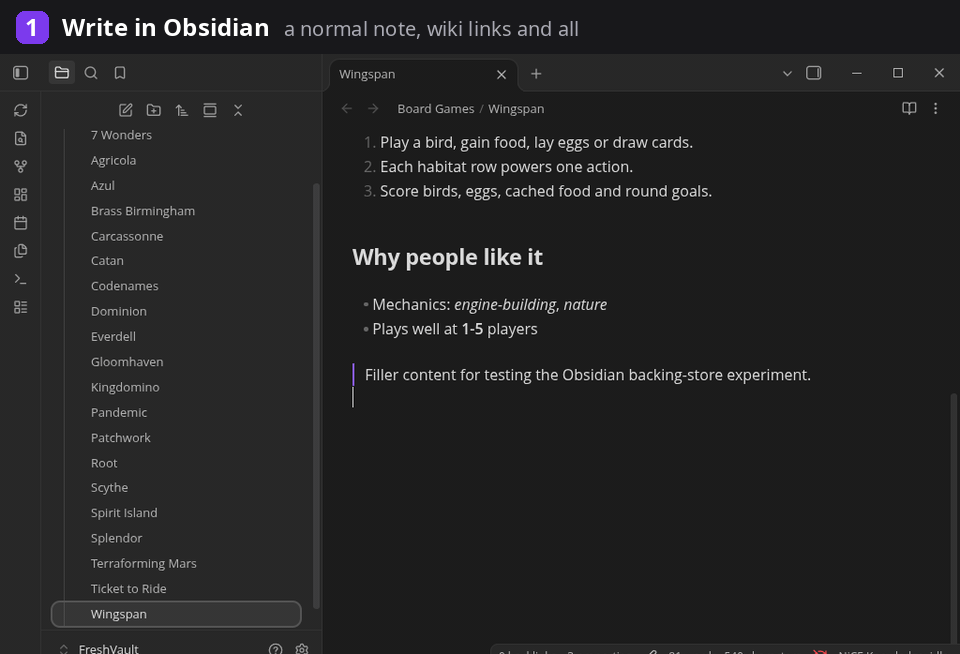
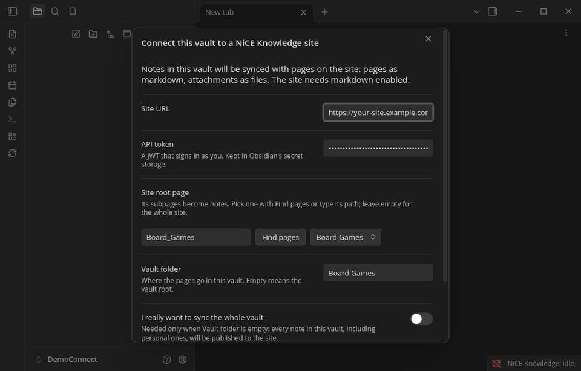
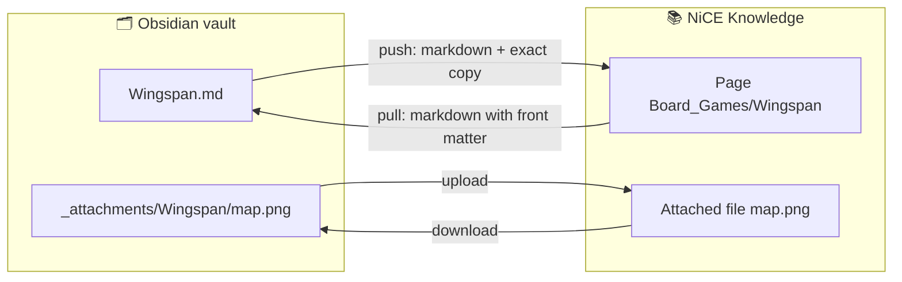
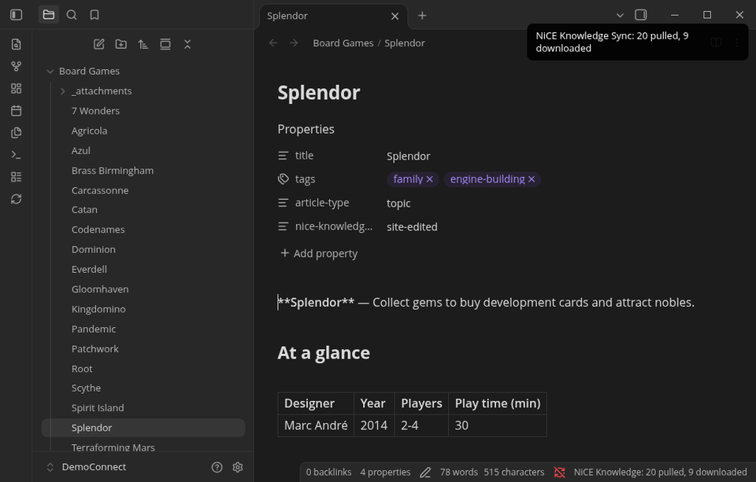

<h1 align="center">NiCE Knowledge Sync for Obsidian</h1>

<p align="center">
  <b>Write your knowledge base in Obsidian. Publish it to NiCE Knowledge.</b><br>
  Pages become notes, attachments become files, tags become frontmatter, and sync goes both ways.
</p>

<p align="center">
  <a href="https://github.com/skittleson/nice-knowledge-obsidian/actions/workflows/ci.yml"></a>
  <a href="https://github.com/skittleson/nice-knowledge-obsidian/releases"></a>
  
  
  
  <a href="LICENSE"></a>
</p>

<p align="center">
  <a href="#install">Install</a> ·
  <a href="#what-gets-published">What gets published</a> ·
  <a href="#how-sync-works">How it works</a> ·
  <a href="#faq">FAQ</a> ·
  <a href="#development">Development</a>
</p>

<p align="center">
  
</p>

> [!WARNING]
> **This is an experiment, not a supported product.** Try it with a test site, back up your vault, and expect rough
> edges. It writes to your site, but it never deletes anything there without asking you first.

## Why you'd want this

- ✍️ **Write in the editor you like.** Write offline with Obsidian's keyboard shortcuts, wiki links, templates and plugins,
  then publish with one click.
- 🔍 **See your knowledge base as a whole.** Graph view, backlinks and full-text search work across every article you synced.
- 🧹 **Make big edits fast.** Search every article at once, fix the tags on a whole guide, or reorganize pages by
  dragging notes between folders.
- 🤝 **Stay in step with the site.** Edits your team makes in the site editor come back to you, flagged, so you see
  them before you publish over them.
- 🧪 **Learn from it.** It's a working example of using the NiCE Knowledge API as a markdown backing store, along with
  [what that taught us](#what-the-experiment-showed).

## Highlights

| | |
|---|---|
| 🔁 **Two-way sync** | Pull a section of your site into a vault folder, edit offline, push it back |
| 🎯 **Exact round trips** | Notes you write come back exactly the same on your other devices (`%%comments%%` stay on the device that wrote them) |
| 🖼️ **Attachments** | Pasted images and files upload to the page; files on the site download next to the note |
| 🏷️ **Metadata** | `tags`, `title`, `summary` and `article-type` map to page tags, title, overview and article type |
| 🛡️ **Respects site edits** | Notes for pages edited on the site are held until you review them, and stale saves are refused by the server |
| ⚔️ **Conflicts kept** | If both sides changed, you get both versions side by side |
| 🗑️ **Deletes wait for you** | Every delete, in either direction, waits for your OK |
| 🔐 **No secrets in the vault** | The token is kept in Obsidian's secret storage |

### Obsidian with this plugin vs. the site editor alone

| | Site editor | Obsidian + NiCE Knowledge Sync |
|---|---|---|
| Write offline | — | ✅ |
| Work across many articles | One page at a time | Search all of them, edit side by side, move them by dragging |
| Links between articles | Search and paste URLs | `[[wiki links]]` with autocomplete |
| See how articles connect | — | Graph view and backlinks |
| DekiScript and templates | ✅ | Read-only snapshots ([why](#faq)) |
| Styled tables and layout HTML | ✅ | Simplified to markdown |
| Review and approval flows on the site | ✅ | Use the site as usual |

## Before you start

You'll need three things. Usually the first one has to be requested.

1. **Markdown enabled on your site.** It's off by default, and site admins can't turn it on themselves, so **ask your
   NiCE Knowledge contact to enable markdown** for the site you want to use.
2. **An API token for your own user.** On your site, go to **Dashboard → Integrations → API token management**. Generate a
   **Server** token, tick **Generate long-term JWT (OAuth bearer token)**, choose your user, then click **Copy JWT**. The JWT
   is shown only once. You may need a site admin to create it. Sync runs with that user's permissions.
3. **Obsidian 1.11.4 or later, on desktop.** It hasn't been tried on mobile.

## Install

**Option A: BRAT (recommended while it's an experiment)**
1. Install [BRAT](https://github.com/TfTHacker/obsidian42-brat) from Obsidian's community plugins.
2. Open BRAT's settings, choose **Add beta plugin**, and enter `skittleson/nice-knowledge-obsidian`.
3. Turn on **NiCE Knowledge Sync (experimental)**. BRAT also keeps it updated.

**Option B: manual**
Download `main.js` and `manifest.json` from the [latest release](https://github.com/skittleson/nice-knowledge-obsidian/releases)
into `<vault>/.obsidian/plugins/nice-knowledge-sync/`, then turn the plugin on under *Settings → Community plugins*.

**Option C: a new vault from source**

```sh
git clone https://github.com/skittleson/nice-knowledge-obsidian.git
cd nice-knowledge-obsidian && npm install
node scripts/create-vault.mjs --vault ~/Vaults/MySite --site https://your-site.example.com --root Some_Page --open
```

### Connect

Once the plugin is on, the **Connect** screen opens. Enter your site and token, then choose **Find pages** to pick the part
of the site to sync. That page's subpages become notes in the vault folder named after it. Choose **Connect and sync**
and the pages arrive. After that, sync with the ribbon icon or the **Sync now** command.

<p align="center"></p>

> [!TIP]
> Keep the site in its own **vault folder** so your personal notes stay private. The plugin refuses to sync a whole
> vault unless you explicitly turn that on.

## What gets published

Here's what leaves your device when you sync:

- **The page body:** your note converted to standard markdown. Wiki links become site links, embeds become file links,
  and `==highlights==` become `<mark>`. `%%comments%%` are removed.
- **A stored copy of the note:** kept in a page property so your other devices get the note back exactly. It includes
  your **frontmatter**, but not your **comments** (unless you turn on *Publish %%comments%%*). Anyone who can read the
  page through the API can read this copy.
- **Attachments** embedded in the note, or placed in its `_attachments/<note>/` folder.
- **Only notes inside the vault folder you chose.**

The token stays in Obsidian's secret storage, and the sync bookkeeping stays in this device's local storage. Neither is
written to the vault, and the plugin only talks to your site.

## How sync works



| In Obsidian | On the site |
|---|---|
| The vault folder | The root page you chose |
| `Note.md` | A page under its folder's page |
| `Folder/` with `Folder.md` beside it | A parent page and its content |
| `![[image.png]]` | A file attached to that page |
| `[[Other note]]` | A link to that page |
| `tags:` · `title:` · `summary:` · `article-type:` | Tags · title · overview · article type |

### When the two sides disagree

| Situation | What happens |
|---|---|
| The page was edited on the site, or the plugin didn't write it | The note is updated from the site and flagged `site-edited`. Your edits to it aren't sent until you run **Accept this note as the source** |
| Both sides changed | Both are kept: `Note (knowledge conflict …).md` holds the site version, and your note is flagged `conflict` |
| The page uses DekiScript | You get a read-only snapshot (`dynamic`) that's never sent back |
| A note or page was deleted | It's queued under **Review pending deletes**: Keep or Delete. A page that has child pages is never deleted |
| A note was moved or renamed | The page moves with it |

<p align="center"></p>

> [!CAUTION]
> **Accepting a site-edited note replaces the site version with yours.** The site's markdown export is a little lossy,
> so formatting added in the site editor (styled tables, layout HTML) can be lost. Check the note first. The previous
> version stays in the page's revision history.

<details>
<summary><b>Under the hood</b></summary>

- **Pull:** one `GET pages/{root}/tree` lists every page and its revision. Each changed page is read with `format=markdown`,
  and the front matter the server adds (`revision`, `tags`, `dynamic`) tells the plugin whether the stored copy still matches.
- **Push:** `POST pages/{id}/contents` as `text/markdown`, with `edittime` and `abort=modified` so a stale save is refused.
  The stored copy goes in the `obsidian#source` property, and the revision it was written against goes in `obsidian#sync`.
- **Attachments:** `PUT pages/{id}/files/{name}`. They're listed again only when a page's revision changes.
</details>

## Commands and settings

| Command | What it does |
|---|---|
| Connect this vault to a NiCE Knowledge site | Opens the setup screen |
| Sync now | Pulls, then pushes. The ribbon icon does the same |
| Accept this note as the source | Clears the `site-edited` / `conflict` flag so your version is sent |
| Review pending deletes | Keep or delete each queued delete |
| Show last sync report | Lists what changed, what was blocked or skipped, and any errors |
| Test connection | Checks the token, the markdown setting and the root page |
| Reset sync state on this device | Starts the bookkeeping over. Nothing is deleted on either side |

**Settings:** site URL · API token · site root page · vault folder · *Sync the whole vault* (off) ·
*Publish %%comments%%* (off) · *Sync every N minutes* (0 = manual)

## FAQ

<details><summary><b>Is my note exactly the same on another device?</b></summary>

Yes for notes you write in Obsidian, except that `%%comments%%` stay on the device that wrote them unless you publish
them. Pages edited on the site arrive as the site's markdown export, which isn't byte-exact.
</details>

<details><summary><b>Will it overwrite what my team edits on the site?</b></summary>

Only if you choose to. Notes for site-edited pages are held until you accept them, and the server refuses saves based on
an older version. Even then, the replaced version stays in the page history.
</details>

<details><summary><b>Why are some notes read-only?</b></summary>

Pages that use DekiScript (templates and dynamic content) come back as a snapshot of how they render, not their
source. Pushing that snapshot would wipe out the script, so those notes are never sent back.
</details>

<details><summary><b>Does it work on mobile?</b></summary>

It hasn't been tested there, so it's marked desktop-only.
</details>

## Known limitations

- Moving **and** editing a note in the same sync looks like a delete plus a new note.
- Two attachments with the same file name on one page collide.
- An attachment replaced on the site isn't noticed until that page's revision changes.
- There's no paging for very large sites. Throttled requests (429/502/503/504) are retried with backoff.
- The root page itself isn't synced, only its subpages.

## What the experiment showed

<details>
<summary>Tested on 2026-10-16 against a NiCE Knowledge test site: what worked and the rough edges</summary>

**What worked**
- With `text/markdown` writes and `format=markdown` reads, the site works as a markdown backing store with no server changes.
  The front matter the server adds (`revision`, `tags`, `dynamic`) is enough to drive sync.
- `GET pages/{root}/tree?include=revision,properties` returns the whole subtree in one call.
- Page properties held a 240 KB note exactly. Writing a property or tags doesn't create a new page revision, so a revision
  change reliably means someone edited the page on the site.
- `edittime` with `abort=modified` stops a save from overwriting a newer edit.

**Rough edges**
- The server's markdown export (HTML → markdown) is lossy, so the exact copy has to live in a property.
- Files and page links come back as absolute URLs (`…/files/{id}/{name}?revision=N`). In uploaded file URLs, spaces become `_`.
- `pages/{id}/info` doesn't include `date.modified`; you need the full `pages/{id}` response for the edit time.
- Moving a page leaves a redirect behind, so moving it back needs `allow=deleteredirects`.
- Deleting a page also archives its child pages, and they can only be restored by restoring the parent.
- On sites that use article types, each page needs a type that's allowed under its parent.
</details>

## Development

```sh
cp .env.example .env          # EXPERT_SITE, EXPERT_ROOT, EXPERT_TOKEN or EXPERT_TOKEN_FILE (git-ignored)
npm install
npm test                      # unit tests
npm run typecheck
node test-e2e/e2e.ts          # live test: two simulated devices against EXPERT_SITE; removes its pages afterwards
node src/node/cli.ts sync --vault ./some-folder --whole-vault
npm run dev                   # rebuild on change
```

<details>
<summary>Project layout</summary>

| Path | Contents |
|---|---|
| `src/core/` | API client, markdown conversion and the sync engine, with no Obsidian dependency |
| `src/obsidian/` | The plugin, its settings, the Connect screen and the vault adapter |
| `src/node/` | Filesystem adapter and CLI used by the live tests |
| `scripts/create-vault.mjs` | Creates a vault that's ready to connect |
| `test/`, `test-e2e/` | Unit tests, the live end-to-end test and an Obsidian DevTools driver |
</details>

**Releasing:** bump `version` in `manifest.json`, `package.json` and `versions.json`, then push a matching tag (for example `0.1.1`).
The release workflow builds the plugin and attaches `main.js` and `manifest.json`.

Never commit tokens. `.env`, `*.token`, sync state files, `.obsidian/` and plugin `data.json` are all git-ignored.

## Contributing

Issues and ideas are welcome. For anything big, open an issue first. Please run `npm test` and `npm run typecheck` before
sending a pull request.

## License

[MIT](LICENSE). Built as an experiment by an engineer on the NiCE Knowledge team; it isn't an officially supported NICE product.
