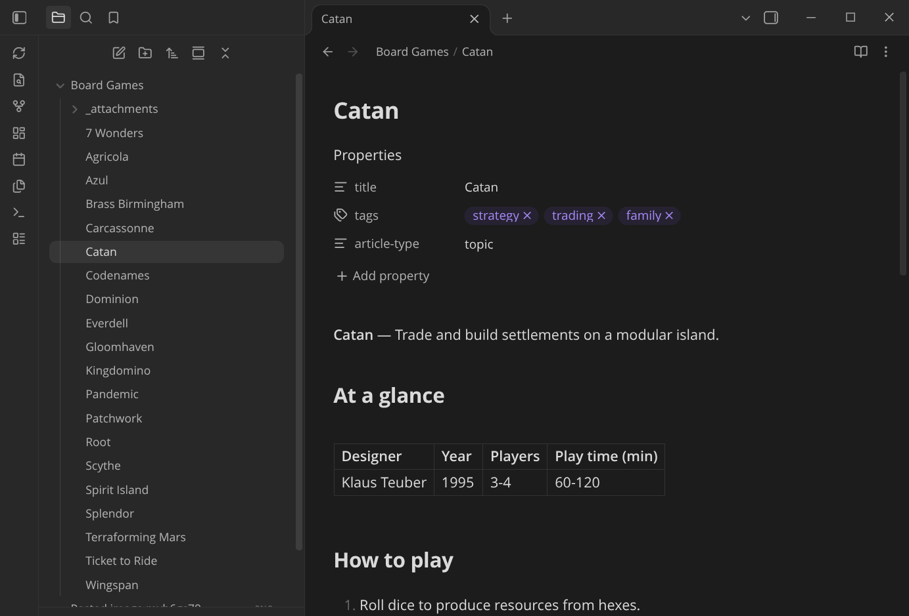

# NiCE Knowledge Sync for Obsidian — an experiment

Edit your NiCE Knowledge pages as notes in Obsidian. Each page under a root page you choose becomes a
markdown note, its attachments become files next to it, and its tags become frontmatter. Sync sends
your changes back and pulls everyone else's.

> [!WARNING]
> **This is an experiment, not a supported product.** Use it with a test site, back up your vault, and
> expect rough edges. It writes to your site, and it never deletes anything there without asking you first.



## Before you start

You need three things. The first one usually takes a request.

1. **Markdown support switched on for your site.** The plugin relies on the `site/markdown-contents-enabled`
   config key. It's off by default, and site admins can't turn it on themselves, so **ask your NiCE
   Knowledge contact to enable it** for the site you want to use.
2. **An API token for your own user.** In the site's **Dashboard → Integrations → API token management**,
   generate a **Server** token, tick **Generate long-term JWT (OAuth bearer token)**, choose your user,
   then **Copy JWT**. It's shown only once. Sync runs with that user's permissions. You may need a site
   admin to create it.
3. **Obsidian 1.11.4 or later on desktop.** The plugin hasn't been tried on mobile.

## Quick start

There’s no release yet, so you need git and Node.js 22.18 or later.

```sh
git clone https://github.com/skittleson/nice-knowledge-obsidian.git
cd nice-knowledge-obsidian && npm install
node scripts/create-vault.mjs --vault ~/Vaults/MySite --site https://your-site.example.com --root Some_Page --open
```

This makes a new vault with the plugin installed and pointed at your site. When it opens, the
**Connect** screen asks for your token. Paste it, choose **Connect and sync**, and the pages arrive.
After that, use the ribbon's sync icon or the **Sync now** command whenever you want to sync.

<details>
<summary>Add it to a vault you already have</summary>

```sh
npm run build
mkdir -p "<vault>/.obsidian/plugins/expert-sync"
cp main.js manifest.json "<vault>/.obsidian/plugins/expert-sync/"
```

Turn on **NiCE Knowledge Sync (experimental)** under *Settings → Community plugins*, and the Connect screen opens.
Pick a **vault folder** for the site. That keeps the rest of your vault private, and the plugin refuses to sync
the whole vault unless you explicitly allow it.
</details>

## What gets published

Before you sync, know what leaves your device:

- **The page body:** your note converted to standard markdown. Wiki links become site links, embeds become
  file links, and `==highlights==` become `<mark>`. `%%comments%%` are removed.
- **A stored copy of the note:** kept in a page property so other devices get the note back exactly. It
  includes your **frontmatter**. **Comments are removed** from it unless you turn on *Publish %%comments%%*.
  Anyone who can read the page through the API can read this copy.
- **Attachments** embedded in the note, or placed in its `_attachments/<note>/` folder.
- **Only notes inside the vault folder you chose.** Syncing the whole vault needs a separate setting.

Your token stays in Obsidian's secret storage, and sync bookkeeping stays in this device's local storage.
Neither is written to the vault. The plugin talks only to your site.

## How sync works

| In Obsidian | On the site |
|---|---|
| The vault folder | The root page you chose |
| `Note.md` | A page under its folder's page |
| `Folder/` with `Folder.md` beside it | A parent page and its content |
| `![[image.png]]` | A file attached to that page |
| `[[Other note]]` | A link to that page |
| `tags:` · `title:` · `summary:` · `article-type:` | Tags · title · overview · IDF article type |

**When the two sides disagree**

| Situation | What happens |
|---|---|
| A page was edited on the site, or the plugin didn't write it | The note is updated from the site's markdown and flagged `nice-knowledge-sync: site-edited`. Your edits to it aren't sent until you run **Accept this note as the source** |
| Both sides changed | Both are kept: `Note (knowledge conflict …).md` holds the site version, and your note is flagged `conflict` |
| The page uses DekiScript | You get a read-only snapshot (`dynamic`), which is never sent back |
| A note or a page was deleted | It's queued. **Review pending deletes** asks Keep or Delete, and a page that has child pages is never deleted |
| A note was moved or renamed | The page moves with it |

> [!CAUTION]
> **Accepting a site-edited note replaces the site version with yours.** The site's markdown export is a
> little lossy, so formatting added in the site's editor (styled tables, layout HTML) can be lost. Check the
> note first; the previous version stays in the page's revision history.

Pushes include the edit time of the version they're based on. If the page changed on the site in the
meantime, the server refuses the save and you get a conflict instead.

<details>
<summary>Under the hood</summary>

- **Pull:** one `GET pages/{root}/tree` lists every page with its revision. Each changed page is read with
  `format=markdown`, and the front matter the server adds (`revision`, `tags`, `dynamic`) decides whether
  the stored copy still matches.
- **Push:** `POST pages/{id}/contents` as `text/markdown` with `edittime` and `abort=modified`. Then the
  stored copy goes into the `obsidian#source` property, and the revision it was written against into `obsidian#sync`.
- **Attachments:** uploaded with `PUT pages/{id}/files/{name}`. They're listed again only when a page's revision changes.
</details>

## Commands

| Command | What it does |
|---|---|
| Connect this vault to a NiCE Knowledge site | Opens the setup screen |
| Sync now | Pulls, then pushes. Same as the ribbon's sync icon |
| Accept this note as the source | Clears the `site-edited` / `conflict` flag so your version is sent |
| Review pending deletes | Keep or delete each queued delete |
| Show last sync report | What changed, what was blocked or skipped, and any errors |
| Test connection | Checks the token, the markdown setting and the root page |
| Reset sync state on this device | Starts the bookkeeping over. Nothing is deleted on either side |

**Settings:** site URL, API token, site root page, vault folder, *Sync the whole vault* (off), *Publish %%comments%%* (off),
and *Sync every N minutes* (0 means manual).

## FAQ

**Is my note exactly the same on another device?**
Yes for notes you wrote in Obsidian, except that `%%comments%%` stay on the device that wrote them unless
you publish them. Pages edited on the site arrive as the site's markdown export, which isn't byte-exact.

**Will it overwrite what my team edits on the site?**
Only if you choose to. Site-edited notes are held until you accept them, and the server rejects saves based on an
older version. Even then, the replaced version stays in the page history.

**Does it work on mobile?**
It hasn't been tested there, so it's marked desktop-only.

## Known limitations

- Moving **and** editing a note in the same sync looks like a delete plus a new note.
- Two attachments with the same file name on one page collide.
- An attachment replaced on the site isn't noticed until that page's revision changes.
- There's no paging for very large sites. Throttled requests (429/502/503/504) are retried with backoff.
- The root page itself isn't synced, only its subpages.
- The plugin id and its install folder are still `expert-sync`, from before the rename.

## What the experiment showed

Tested on 2026-10-16 against a NiCE Knowledge test site.

**What worked**
- With `text/markdown` writes and `format=markdown` reads, the site works as a backing store with no server
  changes. The front matter the server adds (`revision`, `tags`, `dynamic`) is enough to drive sync.
- `GET pages/{root}/tree?include=revision,properties` returns the whole subtree with revisions and small
  properties inline.
- Page properties held a 240 KB note exactly. Writing properties or tags doesn't change the page revision,
  so the revision is a reliable sign that someone edited the page on the site.
- `edittime` with `abort=modified` stops a save from overwriting a newer edit.

**Rough edges**
- The server's markdown export (HTML → markdown) is lossy, so the exact copy has to live in a property.
- Files and page links come back as absolute URLs (`…/files/{id}/{name}?revision=N`). In uploaded file URLs, spaces become `_`.
- `pages/{id}/info` doesn't include `date.modified`; the full `pages/{id}` response is needed to get the edit time.
- A move leaves a redirect behind, so moving a page back needs `allow=deleteredirects`.
- Deleting a page archives its child pages too, and they can only be restored by restoring the parent.
- On IDF sites every page needs an article type that's allowed under its parent.

## Development

Settings for the CLI, the live tests and `create-vault` go in a `.env` file, which git ignores:

```sh
cp .env.example .env          # EXPERT_SITE, EXPERT_ROOT, EXPERT_TOKEN or EXPERT_TOKEN_FILE
npm install
npm test                      # unit tests
npm run typecheck
node test-e2e/e2e.ts          # live test: two simulated devices against EXPERT_SITE; removes its pages afterwards
node src/node/cli.ts sync --vault ./some-folder --whole-vault
npm run dev                   # rebuild on change
```

| Path | Contents |
|---|---|
| `src/core/` | API client, markdown conversion and the sync engine, with no Obsidian dependency |
| `src/obsidian/` | The plugin, its settings, the Connect screen and the vault adapter |
| `src/node/` | Filesystem adapter and CLI used by the live tests |
| `scripts/create-vault.mjs` | Creates a vault that's ready to connect |
| `test/`, `test-e2e/` | Unit tests, the live end-to-end test and an Obsidian DevTools driver |

Never commit tokens. `.env`, `*.token`, sync state files, `.obsidian/` and plugin `data.json` are all git-ignored.

## Contributing

Issues and ideas are welcome. For anything big, open an issue first. Run `npm test` and `npm run typecheck` before
sending a pull request.

## License

[MIT](LICENSE). Built as an experiment by an engineer on the NiCE Knowledge team; it isn't an officially supported NICE product.
